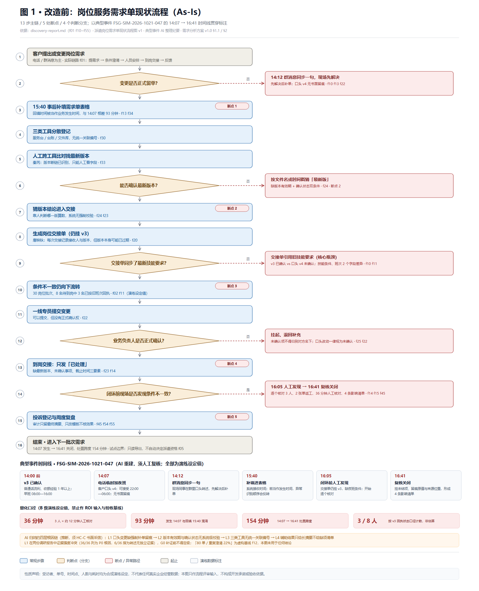
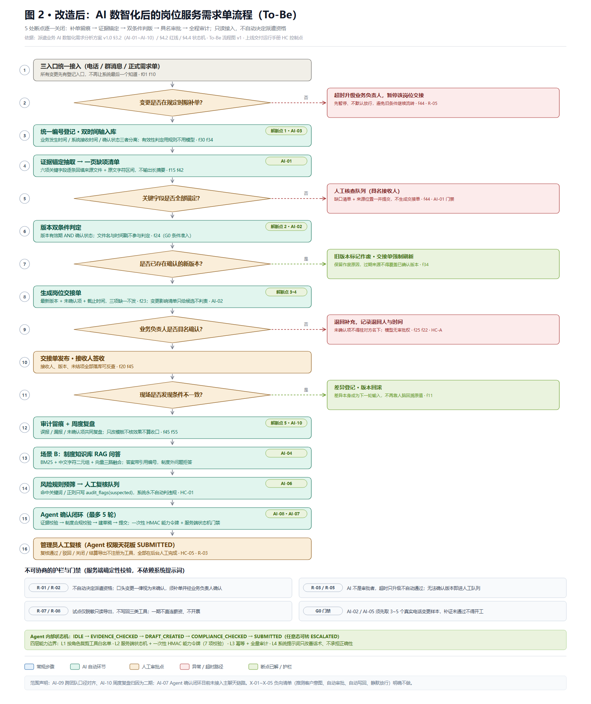

# 派遣业务 AI 数智化：改造前后流程图说明

| 项目 | 内容 |
|---|---|
| 版本 | v1.1（配合 docs/ 目录平铺整理） |
| 整理日期 | 2026-11-06 |
| 图数量 | 2 张（改造前 As-Is、改造后 To-Be），各附 PNG 与 SVG 矢量版 |
| 用途 | 需求评审、方案汇报、上线交付培训；**不是**已确认的业务结论或验收依据 |
| 审核状态 | 待业务负责人、质量负责人书面复核 |

---

## 一、图清单

| 图 | 文件 | 看点 |
|---|---|---|
| 图 1 · 改造前 | `流程图-01-改造前-现状与典型事件.png` / `.svg` | 13 步主链、5 处断点、4 个判断分支；以典型事件 14:07 → 16:41 时间线贯穿标注 |
| 图 2 · 改造后 | `流程图-02-改造后-AI数智化.png` / `.svg` | 5 处断点逐一关闭、AI-01~AI-10 落点、场景 B 确认闭环、红线与门禁 |



> 矢量版：[流程图-01-改造前-现状与典型事件.svg](流程图-01-改造前-现状与典型事件.svg)



> 矢量版：[流程图-02-改造后-AI数智化.svg](流程图-02-改造后-AI数智化.svg)

两张图均为 1680 px 宽的白底竖版图，含菱形判断框、虚线异常分支、右侧分支说明卡与底部图例。建议放大或打开 SVG 阅读。

---

## 二、图 1 · 改造前（As-Is）

### 2.1 主链路

实际链路来自事实编号 **f01**：客户提需求 → 岗位条件澄清 → 人员安排确认 → 到岗交接 → 反馈。图中按 `data/派遣岗位需求单现状流程图v1.html` 的口径展开为 13 个步骤，断点集中在「条件澄清」与「到岗交接」两个交接点之间缺少同步机制。链路本身有 A 级证据，**断点定位属推断（C 级）**。

### 2.2 五处断点

| 断点 | 发生位置 | 现状表现 | 典型事件中的证据 | 事实编号 |
|---|---|---|---|---|
| 1 | 变更后补录 | 回填时间被当作业务发生时间 | 14:07 电话改条件，15:40 才补填表格，相差 93 分钟；若误用回填时间，异常识别顺序整体反转 | f13、f34 |
| 2 | 版本确认 | 按文件名或时间戳猜「最新版」 | v3 已确认、口头 v4 未确认，缺「有效期 + 确认状态」双条件，靠人判断哪版算数 | f24、f30、f33 |
| 3 | 生成交接单 | 交接单仍引用旧技能要求（核心瓶颈） | 交接单挂 v3，缺夜班条件；技能条件与班次共 2 个字段差异；8 名待到岗中 3 名已按旧班次回执 | f10、f11、f14 |
| 4 | 到岗交接 | 只发「已处理」 | 缺最新版本、未确认事项、截止时间三要素；一线可提交变更但无正式确认权 | f23、f22、f25 |
| 5 | 复盘审计 | 审计只留最终摘要、只改模板不核效果 | 看不到谁查过、用哪一版、提了什么建议、谁确认；误报漏报无闭环 | f43、f45、f54、f55 |

### 2.3 典型事件时间线（FSG-SIM-2026-1021-047）

| 时刻 | 事件 | 记录形态 |
|---|---|---|
| 14:00 前 | v3 已确认：普通话流利、收银经验 1 年以上；早班 08:00—16:00 | 已确认版本 |
| 14:07 | 客户电话临时增加「可接受 22:00—06:00 夜班」（口头 v4） | **无书面留痕** |
| 14:12 | 现场同事在群消息同步一句 | 群消息 |
| 15:40 | 变更被补填进表格（系统接收时间） | 表格回填 |
| 16:05 | 闭环前核对发现交接单仍挂 v3，缺夜班条件 | 人工发现 |
| 16:05—16:41 | 逐个核对 3 名人员、标记异常、发起复核、留痕原值与来源位置，形成 4 条影响清单 | 人工复核留痕 |

**量化口径三级分级**（本图所有具体数字均按此标注）：

| 级别 | 含义 | 图中出现项 | 使用限制 |
|---|---|---|---|
| A · 已采集规则 | 源报告有明确事实编号与口径 | 30 岗位批次、交接三要素、版本双条件、两类时间戳、人工复核不可省略 | 可写入需求规格，仍须客户书面确认 |
| B · 演练设定值 | 为还原事件而设的数字 | 3 人 / 8 人、2 班次、2 张单、36 分钟、93 分钟、154 分钟、4 条清单、v3/v4 | **仅限流程演练与文档示例，禁止作基线、ROI 输入或验收指标** |
| C · 明确无统计 | 受访者声明没有数据 | 每单耗时、复核平均耗时、投诉频次、样本量、记录保留期限 | 留空并列入 G0 补证，禁止估算填充 |

> 「80 单 / 重复澄清 22%」是源报告明确标注的**虚构基线 f12**，两张图均未将其用于任何结论。

### 2.4 四层根因链（AI 归纳，须 HC-C 书面采信）

L1 口头变更缺强制补单与留痕入口 → L2 版本有效期与确认状态无系统级强制校验 → L3 三类工具无统一关联编号、拦截点缺失 → L4 辅助结果只给长摘要、不给缺项清单与来源位置。

**证据冲突必须保留**：L1 在 `discovery-report.md`（36/36）被列为 P0 根因，而 `discovery-report(2).md`（6/36）明确指出该现象只是开场设定与受访者转述、无独立证据。G0 补证（3~5 个真实电话变更样本）关闭前，四层链条只作评审输入，不得定级、不得作为开发承诺。

---

## 三、图 2 · 改造后（To-Be）

### 3.1 五处断点如何关闭

| 断点 | 改造后机制 | 对应 AI 改造项 | 门禁 / 人工点 |
|---|---|---|---|
| 1 | 统一编号登记 + 双时间轴入库（业务发生时间 / 系统接收时间 / 确认状态三者分离）；时间表达式由模型抽取，**有效性判定用确定性规则** | AI-03 双时间轴抽取与过期来源拦截 | 时间戳冲突、读取失败保留快照并提示人工核查 |
| 2 | 版本双条件判定（有效期 AND 确认状态），文件名与戳记不参与；旧版本标记作废并保留原因，交接单强制刷新 | AI-02 版本比对与影响清单（**G0 条件准入**） | 复合键仍无法唯一匹配即进人工队列，绝不猜测配对 |
| 3 | 六项关键字段证据锚定抽取 → 一页缺项清单，每字段携带来源文件与原文字符区间；不输出长摘要 | AI-01 字段抽取与证据锚定 | 无法锚定即转具名人工核查队列，**不生成交接单** |
| 4 | 交接单三要素（最新版本 + 未确认项 + 截止时间）缺一不发；口头变更一律「未确认」，补单须业务负责人具名确认 | AI-05 对话式补单助手（**G0 条件准入**） | HC-A 口头变更是否成立；模型无审批权 f22 |
| 5 | 全链路留痕（谁查过、用哪版、提了什么建议、谁确认）+ 周度复盘误报 / 漏报 / 未确认项 | AI-06 风险预筛、AI-10 周度复盘归因 | 系统永不自动判违规；只改模板不核效果不算收口 |

### 3.2 AI-01~AI-10 在流程中的落点

| 编号 | 改造项 | 档位 | 阶段 | 图中位置 |
|---|---|---|---|---|
| AI-01 | 关键字段抽取与证据锚定 | P0（92 分） | W1–W2 | 节点 4 |
| AI-02 | 版本一致性比对与影响清单 | P0（82 分，G0 准入） | W2–W3 | 节点 6、8 |
| AI-03 | 双时间轴抽取与过期来源拦截 | P0（85 分） | W1–W2 | 节点 3 |
| AI-04 | 制度知识库 RAG 问答与引用自检 | P1（88 分） | W1 复验 | 节点 13 |
| AI-05 | 对话式变更补单助手 | P1（75 分，G0 准入） | W3 | 节点 1–2 的补单入口 |
| AI-06 | 风险规则预筛与人工复核队列 | P0（81 分） | W1 | 节点 14 |
| AI-07 | Agent 确认闭环编排 | P1（72 分） | **二期，未接主链路** | 节点 15 |
| AI-08 | 证据校验与制度合规校验 | P0（80 分） | W3 | 节点 15（正确性防线） |
| AI-09 | 跨团队口径对齐辅助 | P2（67 分） | 二期 | 图中未落点 |
| AI-10 | 周度复盘归因与模板优化建议 | P2（66 分） | 二期 | 节点 12 |

### 3.3 场景 B 确认闭环与状态机

- **业务状态机**：`待确认 → 员工确认／异议 → 管理员复核 → 已确认／已关闭`；超时（默认 3 工作日）升级上报，**绝不自动通过**。
- **Agent 内部状态机**：`IDLE → EVIDENCE_CHECKED → DRAFT_CREATED → COMPLIANCE_CHECKED → SUBMITTED`，任意态可转 `ESCALATED`。
- **权限天花板 `SUBMITTED`**：复核通过 / 驳回 / 关闭 / 结算导出不注册为工具，全部由管理员在后台人工完成。
- **四层能力边界**：L1 按角色裁剪工具白名单 · L2 服务端状态机 + 一次性 HMAC 能力令牌（7 项校验） · L3 幂等 + 全量审计 · L4 系统提示词只改善话术、**不承担正确性**。

### 3.4 人工确认 / 审核点

| 编号 | 控制点 | 图中位置 |
|---|---|---|
| HC-A | 口头变更是否成立，发起人补单 + 业务负责人书面确认 | 图 2 节点 9 |
| HC-B | 复核记录是否有效，具名授权确认人签署 | 图 2 节点 16 |
| HC-C | 四层根因链是否采信（对应图 1 底部说明） | 评审环节 |
| HC-D | 量化口径能否使用，G0 补证后冻结基线 | 评审环节 |
| HC-01 / HC-03 / HC-05 | 运行手册登记的最小必做点：对话审计复核、提示词发布、确认单复核关闭 | 图 2 节点 14 / 16 |

### 3.5 不可协商的护栏

- **R-01 / R-02**：不自动决定录用或派遣资格；口头变更一律视为未确认，须补单并经业务负责人确认。
- **R-03 / R-05**：AI 不是审批者，超时只升级不自动通过；无法确认版本或关键字段时进人工队列，必要时暂停试点。
- **R-07 / R-08**：试点仅脱敏只读导出，不写回服务台 / 台账 / 文件库；一期不直连薪资、不开票。
- **G0 门禁**：AI-02 / AI-05 须先取 3~5 个真实电话变更样本，补证未通过不得开工。
- **负向清单 X-01~X-05**：推测客户意图、自动决定派遣资格、自动审批 / 超时自动通过、自动写回与结算、用置信度阈值静默放行未锚定结果，明确不做。

---

## 四、改造前后对照（一页速览）

| 环节 | 改造前 | 改造后 | 依据 |
|---|---|---|---|
| 变更入口 | 电话 / 群消息先发生，系统最后知道 | 三入口统一登记，超时升级并暂停交接 | f10、f22、f44 |
| 时间口径 | 15:40 回填被当作 14:07 发生 | 双时间轴分离，规则拦截过期来源 | f13、f34 |
| 版本判定 | 按文件名 / 时间戳猜 | 有效期 AND 确认状态双条件，作废保留原因 | f24、f30 |
| 辅助结果 | 长摘要，一线无法对应到单据 | 一页缺项清单 + 来源位置（原文字符区间） | f15、f42 |
| 交接单 | 只发「已处理」，缺三要素 | 最新版本 + 未确认项 + 截止时间，缺一不发 | f23、f14 |
| 确认权 | 一线可提交、无正式确认权，模型若接入易越权 | 补单强制「未确认」，业务负责人具名确认，Agent 止于 SUBMITTED | f22、f25、R-03 |
| 审计复盘 | 只留最终摘要，只改模板 | 全量留痕 + 误报 / 漏报 / 未确认项周度复盘 | f45、f54、f55 |
| 失败兜底 | 静默默认通过、不确定性带进交接单 | 未锚定 / 低置信 / 冲突 / 越权一律进具名人工队列 | f31、f44 |

---

## 五、图例

| 颜色 | 含义 |
|---|---|
| 浅蓝 | 常规步骤 |
| 浅绿 | AI 自动化环节（仅图 2） |
| 浅橙 / 菱形 | 判断点与人工审批点 |
| 浅红 | 断点、异常与超时路径 |
| 浅灰 | 起止节点与演练数据标注 |
| 绿色徽章 | 断点已解 / AI 改造项编号（仅图 2） |

---

## 六、复现命令

```bash
# 重新生成两张图（SVG + PNG，PNG 需本机 Chrome / Edge）
python docs/make_flowcharts.py

# 重新生成访谈三格式
python docs/build_interviews.py

# 重新生成两份 docx 的中间 HTML
python docs/build_html.py
```

`make_flowcharts.py` 只用 Python 标准库生成 SVG；PNG 由无头浏览器截图，可用 `CHROME_PATH` 指定浏览器路径。若没有浏览器，脚本仍会输出 SVG，可直接用浏览器打开并另存为 PNG / PDF。

> `build_html.py` 复用的排版引擎位于 `output/上线交付运行手册-v1.0/html/build_html.py`。该目录属流水线工作区、被 `.gitignore` 排除、未随仓库分发；在全新克隆中需先恢复该引擎才能复现 docx 转换。

---

## 七、引用材料与性质声明

- `docs/discovery-report.md`、`docs/discovery-report(2).md`：f00~f55 事实编号、四来源框架、两份报告的证据强度分歧。
- `data/派遣岗位需求单现状流程图v1.html`：改造前 13 步 / 5 断点 / 判断分支。
- `scripts/docx-build/tobe-flow.html`：改造后 5 处断点的解法与菱形分支设计。
- `docs/典型事件采访记录.txt`、`docs/典型事件AI整理纪要.md`：6 轮逐字稿、时间线、量化三级分级、HC-A~HC-D。
- `派遣业务 AI 数智化需求分析方案 v1.0`：12 痛点、10 项 AI 改造、优先级评分、红线 R-01~R-08、G0 门禁、追溯矩阵。
- `项目上线交付运行手册 v1.0`：HC-01 / HC-03 / HC-05 人工控制点、D-01~D-06 已知缺陷。

**性质声明**：受访者、单号、时间点、人数与耗时均为合成演练设定，不代表任何真实企业经营数据；所有 B 级数字禁止进入 ROI 模型与验收指标。四层根因链为 AI 推断且存在证据冲突，须由业务与质量负责人逐层书面确认或推翻。图 2 描述的是**目标态设计**，其中 AI-07 尚未接入主聊天链路、AI-09 / AI-10 属二期；当前线上 MVP 仍是演示环境，不是生产系统。
