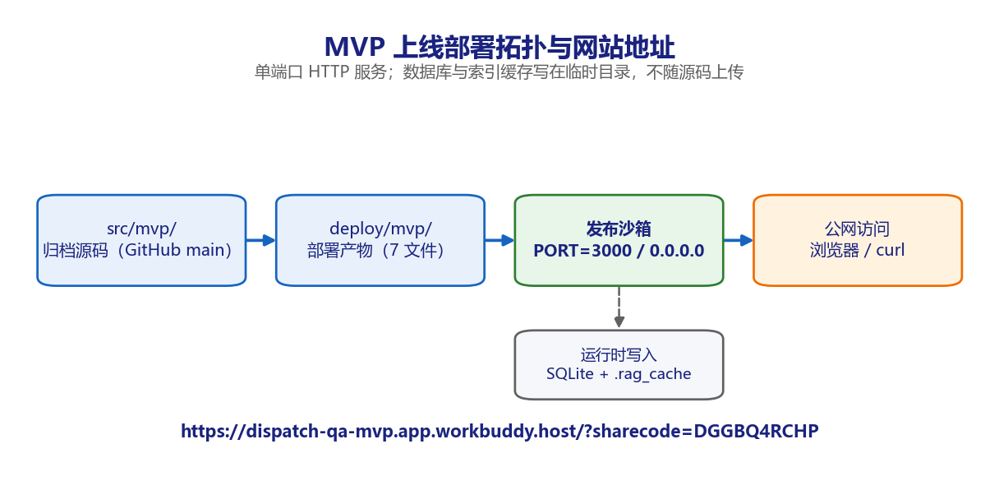

# 派遣项目考勤异常双向确认系统 · MVP 系统上线部署地址说明 v1.0

**版本** v1.0（部署交付文档，2026 年 11 月 6 日）
**适用对象** 运维负责人、交付经理、客户验收代表、演示环境访问者

---

## 1. 上线部署网站地址

| 项目 | 内容 |
| --- | --- |
| 分享链接 | `https://dispatch-qa-mvp.app.workbuddy.host/?sharecode=DGGBQ4RCHP` |
| 应用名称 | 派遣问答MVP演示 |
| 部署类型 | 单端口 HTTP 服务（Python / FastAPI） |
| 部署状态 | 发布成功，`verified=true` |
| 监听方式 | 读取 `PORT` 环境变量（平台注入 3000），绑定 `0.0.0.0` |
| 部署产物 | `deploy/mvp/`，共 7 个文件 |
| 应用管理入口 | 「设置—数据管理—应用」 |

`sharecode` 是分享链接的访问凭据，**转发时必须带完整查询串**；只输入域名不带 `sharecode` 可能无法正常打开。该链接对应的是 MVP 演示环境，不是生产系统。

## 2. 部署拓扑



链路为：`src/mvp/` 归档源码 → `deploy/mvp/` 部署产物 → 发布沙箱（`PORT=3000` / `0.0.0.0`）→ 公网浏览器或 curl。数据库与 FAISS 索引缓存写在沙箱临时目录，不随源码上传；上传前已确认目录内无 `.db`、`.faiss`、`.pyc` 与 `__pycache__`。

## 3. 线上验证记录

| 编号 | 验证项 | 请求 | 实测结果 | 往返时延 |
| --- | --- | --- | --- | --- |
| O-01 | 健康检查 | GET /health | 200；status=ok；engine_ready=true；chunks=11；vector_enabled=false；llm_model=mock | 350.69 ms |
| O-02 | 首页 | GET / | 200；18,393 字节单页 HTML | 507.36 ms |
| O-03 | 未知路由 | GET /api/no-such-route | 404；中文错误体 | 390.43 ms |
| O-04 | SSE 问答 | POST /chat「差旅住宿费上限是多少」 | 200；22 帧；事件序完整；引用命中 2.2 住宿费 | 343.80 ms |

四项全部符合预期。O-04 的事件序列为 `meta → status(retrieving) → citations → status(generating) → delta* → done`，与 `src/mvp/README.md` 的接口契约一致。

手工复核命令：

```bash
curl -s "https://dispatch-qa-mvp.app.workbuddy.host/health?sharecode=DGGBQ4RCHP"
curl -sN -H 'Content-Type: application/json' \
  -d '{"question":"差旅住宿费上限是多少"}' \
  "https://dispatch-qa-mvp.app.workbuddy.host/chat?sharecode=DGGBQ4RCHP"
```

## 4. 部署产物与可复现启动

| 文件 | 与归档源码的关系 |
| --- | --- |
| rag_engine.py / static/index.html / 报销制度.md | 与 `src/mvp/` 字节一致 |
| main.py | 仅增加一行：`CFG.index_dir` 可由 `INDEX_DIR` 覆盖 |
| serve.py | 新增。设置 `DB_PATH` / `INDEX_DIR` 到临时目录，读取 `PORT` 并绑定 `0.0.0.0` |
| requirements.txt / README.md | 新增。部署依赖与安全声明 |

```bash
cd deploy/mvp
pip install -r requirements.txt
python serve.py                 # 默认 PORT=8000
PORT=3000 python serve.py       # 发布平台注入端口
```

`serve.py` 必须在 import `main` 之前设置环境变量，因为 `main.py` 在模块加载期就读取 `DB_PATH` 与 `INDEX_DIR`。若改用 uvicorn 直接启动，等价命令为 `python -m uvicorn main:app --host 0.0.0.0 --port $PORT`。

## 5. 安全声明与访问限制

- 演示环境**匿名、无登录、无租户隔离、无审计**，禁止录入任何真实员工、客户或经营数据。
- 知识源 `报销制度.md` 是原型阶段编写的示例制度，文档首行明确「非真实经营制度」。
- 未配置 `LLM_API_KEY`，服务以 `hash` embedding（纯 BM25）＋ `MockLLM` 运行，回答为链路演示内容，不具备业务参考价值；MockLLM 会回显提示词前 300 字，生产环境必须禁用。
- 数据库与索引缓存写在沙箱临时目录，不保证持久，不得当作业务数据存储。
- 同一 IP 在 60 秒内超过 20 次 `/chat` 会返回 429 / 42901；该限流为进程内存计数，多实例不共享。
- 完整实现仍有 12 项 P0 上线阻塞未关闭，见 `docs/上线前检查清单-派遣考勤异常双向确认-v1.0.md`。本链接**不代表生产放行**。

## 6. 巡检与常见处置

| 频率 | 检查项 | 通过标准 |
| --- | --- | --- |
| 每次发布 | `/health` 与首页 | 200 且 chunks 非零 |
| 每日 | 5xx 与 429 计数 | 5xx = 0；429 在预期范围 |
| 每周 | 制度文档与提示词版本 | 与后台显示一致 |
| 每周 | 备份与恢复演练 | 备份可恢复 |

| 现象 | 处置 |
| --- | --- |
| 429 / 42901 | 等待 60 秒窗口，或生产环境改 Redis 分布式限流 |
| 503 / 50001 | 检查 `DOC_PATH` 指向的制度文件，服务会拒绝启动而非带病运行 |
| SSE 一次性全出来 | 确认反代保留 `Cache-Control: no-cache` 与 `X-Accel-Buffering: no` |
| 中文乱码 | 客户端明确使用 UTF-8，curl 用 `--data-urlencode` |

## 7. 下线与回滚

1. 在「设置—数据管理—应用」中对本应用执行下线，分享链接立即失效；下线属破坏性操作，须由交付经理确认。
2. 保留 `deploy/mvp/` 当前 7 个文件与 `results/` 下全部测试证据，不得覆盖。
3. 需要恢复上一版本时，从 `src/mvp/` 重新复制三个核心文件与 `main.py`，重跑 `PYTHON=<已装依赖解释器> bash scripts/build.sh`（7 项全通过）后再发布。
4. 重新发布同样走「设置—数据管理—应用」，发布为覆盖操作，已有分享链接保持不变。

## 8. 版本记录

| 版本 | 日期 | 变更 | 编制 |
| --- | --- | --- | --- |
| v1.0 | 2026-11-06 | 首次部署 MVP 演示环境并记录线上地址、验证结果与安全边界 | 项目组 |
