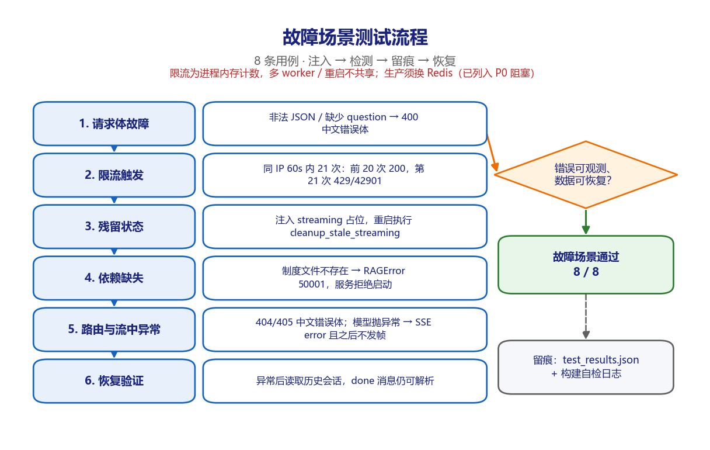
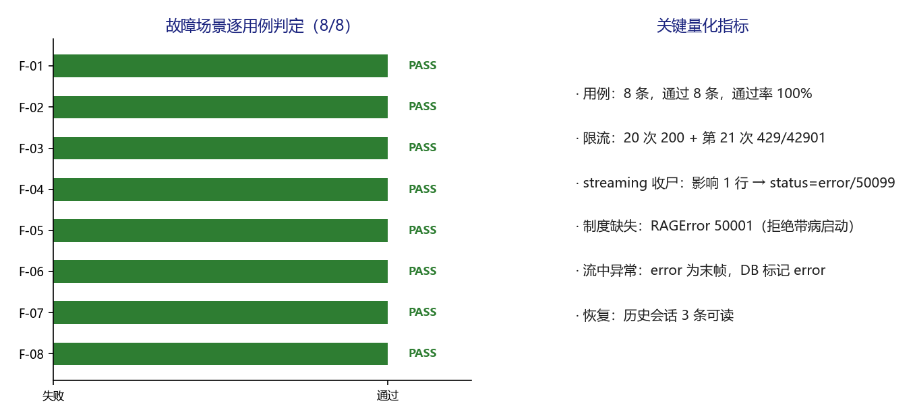

# 派遣项目考勤异常双向确认系统 · 故障场景测试 v1.0

**版本** v1.0（可视化测试过程文档，TC-FAULT-2026-1106，2026 年 11 月 6 日）
**适用对象** 测试负责人、安全评审、运维负责人、客户验收代表

---

## 1. 场景说明与测试目标

验证异常请求、限流、残留状态、依赖缺失、路由错误与流中异常均可被观测、可留痕、可恢复，服务不进入「能连上但必错」的带病状态。

故障注入全部在本地 `TestClient` 内完成，包括非法 JSON、缺失字段、限流突发、手工注入 streaming 占位、指向不存在的制度文件、未知路由与方法错误，以及 monkeypatch `chat_stream` 抛异常。

F-03 是唯一不清空内存限流计数的用例，用于观测真实的 20 次 / 60 秒阈值；其余用例执行前均清空计数以保证隔离。

## 2. 环境与执行基线

| 项目 | 基线 |
| --- | --- |
| 被测对象 | `deploy/mvp/`（A 层）与 `src/attendance_agent/`（B 层） |
| 执行方式 | `fastapi.testclient.TestClient` 触发 lifespan，逐条执行并写 JSON |
| 用例数量 | 8 条，通过 8 条，失败 0 条 |
| 执行日期 | 2026-11-06 |
| 证据文件 | `results/test_results.json`、`results/build_selfcheck.log` |
| 隔离措施 | 非限流用例前清空内存限流计数；每次执行前清空临时数据库 |

## 3. 测试过程流程图

*图 3-1 故障注入、检测、留痕与恢复流程。图中左列为实际执行的六个步骤，右侧菱形为场景判定条件，绿色框为结论，灰色框为留痕位置。*

## 4. 逐步过程记录

| 步骤 | 动作 | 过程与观测 |
| --- | --- | --- |
| 1 | 请求体故障 | 非法 JSON 返回 400 / 40002「请求参数不合法」；缺少 question 字段同样返回 400 / 40002，四段错误体齐备。 |
| 2 | 限流触发 | 同一 IP 连续 21 次 /chat：前 20 次全部 200，第 21 次 429 / 42901，阈值与错误码精确命中。 |
| 3 | 残留状态 | 手工插入 1 条 `streaming` 占位消息后调用 `cleanup_stale_streaming()`，影响 1 行，复查为 `status=error`、`error_code=50099`。 |
| 4 | 依赖缺失 | 把 `doc_path` 指向不存在的制度文件构造 RAGEngine，抛 `RAGError 50001`，服务选择启动失败而不是带病运行。 |
| 5 | 路由与流中异常 | 未知路由 404 / 40401、GET /chat 405 / 40501；monkeypatch 模型抛异常后，SSE 的 error 为末帧且之后不再发帧，DB 中 assistant 消息标 error。 |
| 6 | 恢复验证 | 异常用例后读取历史会话，返回 200 且 3 条消息可读，已完成的 done 消息不受故障影响。 |

每一步均先记录输入，再执行请求或调用，随后解析响应 / 数据库状态，最后与量化期望比对；任何一项不满足即记 FAIL 并保留实测值。

## 5. 逐用例执行结果

| 编号 | 用例 | 具体输入 | 量化期望 | 实测结果 | 结论 |
| --- | --- | --- | --- | --- | --- |
| F-01 | 非法 JSON 请求体 | {not json | 400；统一四段中文错误体 | 400 / 40002 / 请求参数不合法 | PASS |
| F-02 | 缺少必填字段 | {'session_id': ...} | 400 / code=40002 | 400 / 40002 | PASS |
| F-03 | 限流阈值与错误码 | 同一 IP 60s 内 21 次 /chat | 前 20 次 200，第 21 次 429 / 42901 | 前20={200}；第21=429 / code=42901 | PASS |
| F-04 | 重启后残留 streaming 收尸 | 手工注入 1 条 streaming 消息 | cleanup 影响 1 行；状态转 error 且写入 50099 | 影响 1 行；[{'status': 'error', 'error_code': 50099}] | PASS |
| F-05 | 制度文件缺失时拒绝启动 | doc_path 指向不存在文件 | 抛 INDEX_NOT_READY(50001)，服务不得进入「能连上但必错」状态 | RAGError 50001 | PASS |
| F-06 | 未知路由与错误方法 | GET /api/no-such-route、GET /chat | 404 / 40401 与 405 / 40501，均为中文错误体 | 404/40401；405/40501 | PASS |
| F-07 | 流中模型异常与留痕 | monkeypatch chat_stream 抛异常 | 发 error 且之后不再发帧；DB 中 assistant 标 error | 事件末尾=error；error 后无帧=True；DB=[{'status': 'error', 'error_code': 50099}] | PASS |
| F-08 | 故障后数据可恢复 | 异常用例后读取历史会话 | 200；历史消息仍在；status=done 的消息可正常解析 | 200；messages=3 | PASS |

*图 5-1 故障场景八条用例判定与关键量化指标。左图逐条给出 PASS / FAIL 判定，右图汇总本场景的关键量化指标。*

## 6. 关键观测与发现

- **D-03（P0）**：限流为进程内存计数，多 worker 或重启后不共享；本用例通过不代表生产限流可用，须换 Redis 并补多实例压测。

- 错误可观测性良好：每个故障都有对应错误码、中文提示与数据库留痕，流中异常不会留下永久 `streaming` 悬挂记录。

- 归档版统一异常处理器会把异常类型带进 `detail` 便于离线排查，生产环境应改为只回通用提示，避免内部实现细节外泄。

## 7. 场景判定与签字

8 / 8 通过，场景通过率 100%，M-06 与 M-10 达标。D-03 仍为 P0 阻塞，生产放行前必须完成 Redis 限流改造与回滚演练。

判定规则：本场景全部用例断言满足才记通过；任一 P0 用例失败则整体不通过，须修复后全量重跑。本场景结论只覆盖 MVP 演示环境，不构成生产上线放行。

| 角色 | 姓名 | 签字 | 日期 |
| --- | --- | --- | --- |
| 执行测试工程师 |  |  |  |
| 复核人 |  |  |  |
| 客户验收代表 |  |  |  |
