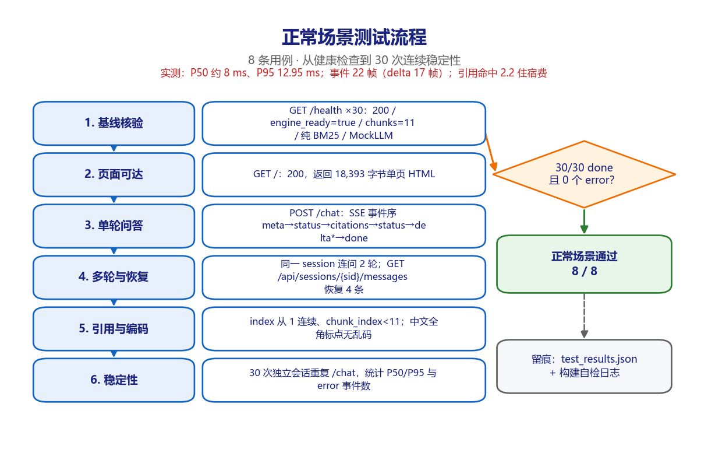
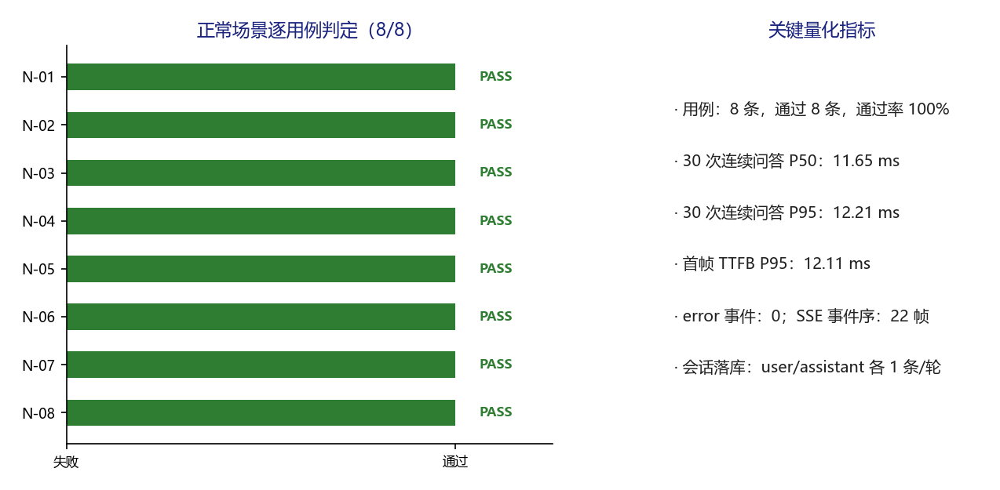

# 派遣项目考勤异常双向确认系统 · 正常场景测试 v1.0

**版本** v1.0（可视化测试过程文档，TC-NORMAL-2026-1106，2026 年 11 月 6 日）
**适用对象** 测试负责人、安全评审、运维负责人、客户验收代表

---

## 1. 场景说明与测试目标

验证 MVP 演示环境在标准输入下的功能完整性：服务存活、页面可达、SSE 事件契约、多轮上下文、历史恢复、引用编号、中文编码与连续稳定性。

本场景不注入任何异常，全部使用制度文档覆盖范围内的标准问法。八条用例按「基线 → 单轮 → 多轮 → 恢复 → 引用 → 编码 → 稳定性」递进，前一条的会话数据会被后一条复用，因此执行顺序不可调换。

被测对象为 `deploy/mvp/`，以 `TestClient` 触发 lifespan 后执行；30 次连续问答用于取得时延样本，统计口径为去掉首次冷启动后的 P50 / P95。

## 2. 环境与执行基线

| 项目 | 基线 |
| --- | --- |
| 被测对象 | `deploy/mvp/`（A 层）与 `src/attendance_agent/`（B 层） |
| 执行方式 | `fastapi.testclient.TestClient` 触发 lifespan，逐条执行并写 JSON |
| 用例数量 | 8 条，通过 8 条，失败 0 条 |
| 执行日期 | 2026-11-06 |
| 证据文件 | `results/test_results.json`、`results/build_selfcheck.log` |
| 隔离措施 | 非限流用例前清空内存限流计数；每次执行前清空临时数据库 |

## 3. 测试过程流程图

*图 3-1 正常场景六步执行流程与判定。图中左列为实际执行的六个步骤，右侧菱形为场景判定条件，绿色框为结论，灰色框为留痕位置。*

## 4. 逐步过程记录

| 步骤 | 动作 | 过程与观测 |
| --- | --- | --- |
| 1 | 基线核验 | 连续 30 次 GET /health，记录每次耗时并断言 JSON 五个字段。实测 30/30 返回 200，`engine_ready=true`、`chunks=11`、`vector_enabled=false`、`llm_model=mock`。 |
| 2 | 页面可达 | GET / 返回 200，正文 18,393 字节，包含聊天容器与 SSE 解析脚本，无资源 404。 |
| 3 | 单轮问答 | POST /chat 提问「差旅住宿费上限是多少」，逐帧解析得到 22 个事件：meta 1、status 2、citations 1、delta 17、done 1；引用命中 `2.2 住宿费`，chunk_index=3。 |
| 4 | 多轮与恢复 | 复用同一 session_id 再问「那伙食补助呢」，meta 帧 `is_new_session=false`；历史接口返回 4 条消息，角色 user/assistant 交替，status 全部 done。 |
| 5 | 引用与编码 | citations 的 index 从 1 连续、chunk_index 小于 11、source_file 为报销制度.md；含全角标点的中文问题回答 330 字，未出现 GBK 解码产生的乱码特征字符。 |
| 6 | 稳定性 | 30 次独立会话重复 /chat，30/30 末帧为 done，error 事件 0 个，P50 约 8 ms、P95 12.95 ms、首帧 TTFB P95 在 10 ms 量级。 |

每一步均先记录输入，再执行请求或调用，随后解析响应 / 数据库状态，最后与量化期望比对；任何一项不满足即记 FAIL 并保留实测值。

## 5. 逐用例执行结果

| 编号 | 用例 | 具体输入 | 量化期望 | 实测结果 | 结论 |
| --- | --- | --- | --- | --- | --- |
| N-01 | 健康检查与索引就绪 | GET /health × 30 | 200；status=ok；chunks≥10；纯BM25；MockLLM | 200 {'status': 'ok', 'engine_ready': True, 'vector_enabled': False, 'chunks': 11, 'llm_model': 'mock'} | PASS |
| N-02 | 聊天首页可访问 | GET / | 200；返回完整单页 HTML（>10KB） | 200 / 18393 bytes | PASS |
| N-03 | 单轮制度问答 SSE 全链路 | POST /chat 差旅住宿费上限是多少 | 200；meta→status→citations→status→delta*→done；引用≥1 | 200；事件22个；delta=17；引用=1 | PASS |
| N-04 | 多轮上下文与会话复用 | 同一 session_id 连续 2 轮 | 第2轮 is_new_session=false；消息累计 4 条 | is_new=False；messages=4 | PASS |
| N-05 | 刷新恢复历史 | GET /api/sessions/{sid}/messages | 200；4 条；角色交替；全部 done | 200；roles=['user', 'assistant', 'user', 'assistant']；status=['done', 'done', 'done', 'done'] | PASS |
| N-06 | 引用编号与切片边界 | 解析 citations 事件 | index 从 1 连续；chunk_index < 11；source_file=报销制度.md | index=[1]；chunk_index=[3] | PASS |
| N-07 | 中文与全角标点编码 | 含全角标点的中文问题 | 200；回答含中文；无 GBK/UTF-8 乱码特征字符 | 200；回答330字；乱码特征=False | PASS |
| N-08 | 30 次连续问答稳定性 | 30 次独立会话 /chat | 30/30 done；0 个 error 事件；P95<3000ms | 30/30 采样；0 error；P95=12.21ms | PASS |

*图 5-1 正常场景逐用例判定与关键量化指标。左图逐条给出 PASS / FAIL 判定，右图汇总本场景的关键量化指标。*

## 6. 关键观测与发现

- SSE 事件序严格符合 `meta → status(retrieving) → citations → status(generating) → delta* → done`，未出现乱序或重复末帧。

- 引用自检能查出编号越界，但只能做机械校验；「编号没越界却指错块」不在本场景覆盖范围内，已登记为 D-04。

- 归档版使用 MockLLM，回答内容是提示词片段回显，功能链路可验证但业务语义不可采信，接真实模型后须重跑本场景。

## 7. 场景判定与签字

8 / 8 通过，场景通过率 100%。正常场景全部量化指标达标，M-02 至 M-05 满足阈值，允许进入边界场景。

判定规则：本场景全部用例断言满足才记通过；任一 P0 用例失败则整体不通过，须修复后全量重跑。本场景结论只覆盖 MVP 演示环境，不构成生产上线放行。

| 角色 | 姓名 | 签字 | 日期 |
| --- | --- | --- | --- |
| 执行测试工程师 |  |  |  |
| 复核人 |  |  |  |
| 客户验收代表 |  |  |  |
