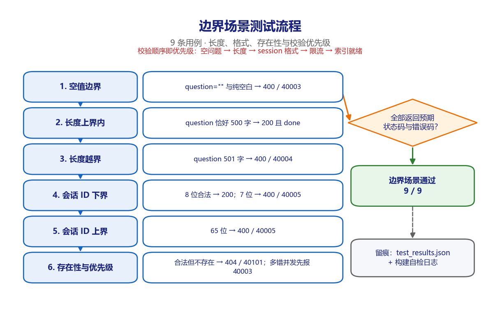
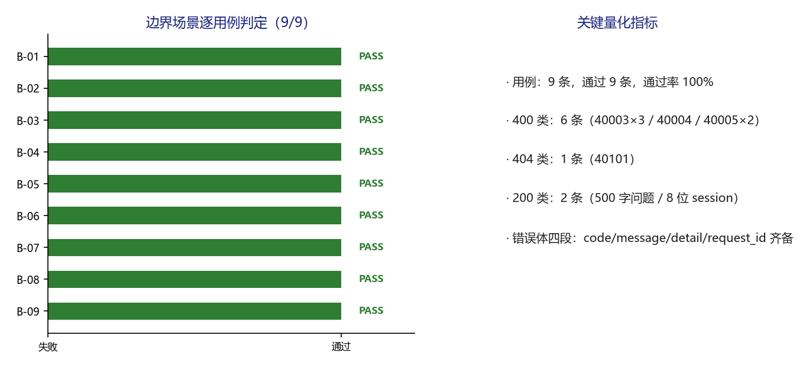

# 派遣项目考勤异常双向确认系统 · 边界场景测试 v1.0

**版本** v1.0（可视化测试过程文档，TC-BOUNDARY-2026-1106，2026 年 11 月 6 日）
**适用对象** 测试负责人、安全评审、运维负责人、客户验收代表

---

## 1. 场景说明与测试目标

验证所有输入约束在临界值上「内收外拒」：问题长度 0 / 500 / 501，会话 ID 长度 7 / 8 / 65，合法但不存在，以及多错并发时的校验优先级。

边界值来自 `rag_engine.Config.max_question_len=500` 与 `main.SESSION_ID_RE` 的 8 至 64 位约束。九条用例全部使用真实 HTTP 请求，不做 mock 替换。

特别验证 B-09：当空问题与非法 session_id 同时出现时，服务端按「空问题 → 长度 → 会话格式 → 限流 → 索引就绪」的固定顺序校验，先返回 40003 而不是 40005。

## 2. 环境与执行基线

| 项目 | 基线 |
| --- | --- |
| 被测对象 | `deploy/mvp/`（A 层）与 `src/attendance_agent/`（B 层） |
| 执行方式 | `fastapi.testclient.TestClient` 触发 lifespan，逐条执行并写 JSON |
| 用例数量 | 9 条，通过 9 条，失败 0 条 |
| 执行日期 | 2026-11-06 |
| 证据文件 | `results/test_results.json`、`results/build_selfcheck.log` |
| 隔离措施 | 非限流用例前清空内存限流计数；每次执行前清空临时数据库 |

## 3. 测试过程流程图

*图 3-1 边界场景取值矩阵与判定流程。图中左列为实际执行的六个步骤，右侧菱形为场景判定条件，绿色框为结论，灰色框为留痕位置。*

## 4. 逐步过程记录

| 步骤 | 动作 | 过程与观测 |
| --- | --- | --- |
| 1 | 空值边界 | question 为空串与纯空白（含制表符）各 1 次，均返回 400 / 40003，错误体为中文且四段结构齐备。 |
| 2 | 长度上界内 | 500 个汉字的问题返回 200，SSE 末帧为 done，证明上界是「小于等于」而非「小于」。 |
| 3 | 长度越界 | 501 个汉字返回 400 / 40004，detail 中带当前字数与上限，便于前端提示。 |
| 4 | 会话 ID 下界 | 8 位 `c_123456` 返回 200；7 位 `c_12345` 返回 400 / 40005。 |
| 5 | 会话 ID 上界 | 65 位（c_ 加 63 个 a）返回 400 / 40005，与正则上界一致。 |
| 6 | 存在性与优先级 | 合法但不存在的会话返回 404 / 40101；空问题叠加非法 session 返回 40003，验证校验优先级。 |

每一步均先记录输入，再执行请求或调用，随后解析响应 / 数据库状态，最后与量化期望比对；任何一项不满足即记 FAIL 并保留实测值。

## 5. 逐用例执行结果

| 编号 | 用例 | 具体输入 | 量化期望 | 实测结果 | 结论 |
| --- | --- | --- | --- | --- | --- |
| B-01 | 空字符串问题 | question="" | 400 / code=40003 | 400 / 40003 | PASS |
| B-02 | 纯空白问题 | question="   \t  " | 400 / code=40003 | 400 / 40003 | PASS |
| B-03 | 问题长度恰好 500 字（上界内） | len=500 | 200 且 done | 200 / done | PASS |
| B-04 | 问题长度 501 字（越界） | len=501 | 400 / code=40004 | 400 / 40004 | PASS |
| B-05 | session_id 恰好 8 位（下界） | len=8 | 200 | 200 | PASS |
| B-06 | session_id 7 位（越下界） | len=7 | 400 / code=40005 | 400 / 40005 | PASS |
| B-07 | session_id 65 位（越上界） | len=65 | 400 / code=40005 | 400 / 40005 | PASS |
| B-08 | 合法但不存在的会话 | GET /api/sessions/c_missing1/messages | 404 / code=40101 | 404 / 40101 | PASS |
| B-09 | 多错并发时的校验优先级 | 空问题 + 非法 session_id | 先拦截空问题 → 40003（不是 40005） | 400 / 40003 | PASS |

*图 5-1 边界场景九条用例判定与状态码分布。左图逐条给出 PASS / FAIL 判定，右图汇总本场景的关键量化指标。*

## 6. 关键观测与发现

- 九条用例中 400 类 6 条、404 类 1 条、200 类 2 条，全部与预期错误码一一对应，无 5xx。

- 所有错误响应均含 `code / message / detail / request_id` 四段，`message` 为中文，符合接口契约。

- session_id 正则只允许字母数字下划线与连字符，中文与特殊字符会在进入数据库前被拦截，这也是 A-06 SQL 注入用例能通过的同一道防线。

## 7. 场景判定与签字

9 / 9 通过，场景通过率 100%。M-07 达标，输入约束在全部临界值上行为确定，允许进入对抗场景。

判定规则：本场景全部用例断言满足才记通过；任一 P0 用例失败则整体不通过，须修复后全量重跑。本场景结论只覆盖 MVP 演示环境，不构成生产上线放行。

| 角色 | 姓名 | 签字 | 日期 |
| --- | --- | --- | --- |
| 执行测试工程师 |  |  |  |
| 复核人 |  |  |  |
| 客户验收代表 |  |  |  |
