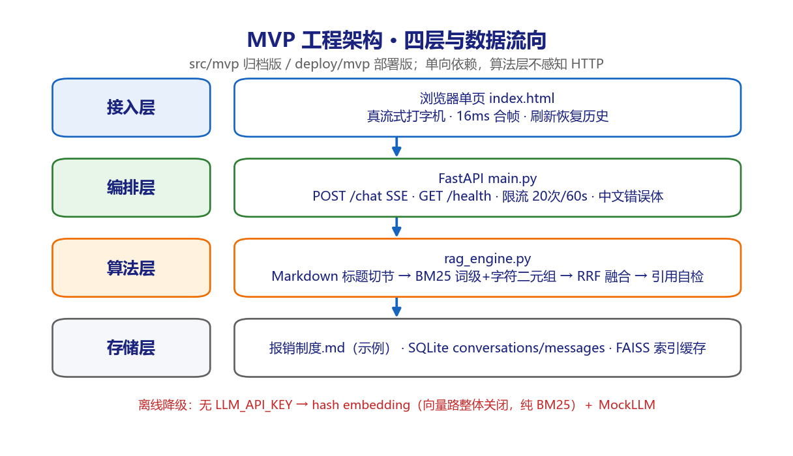
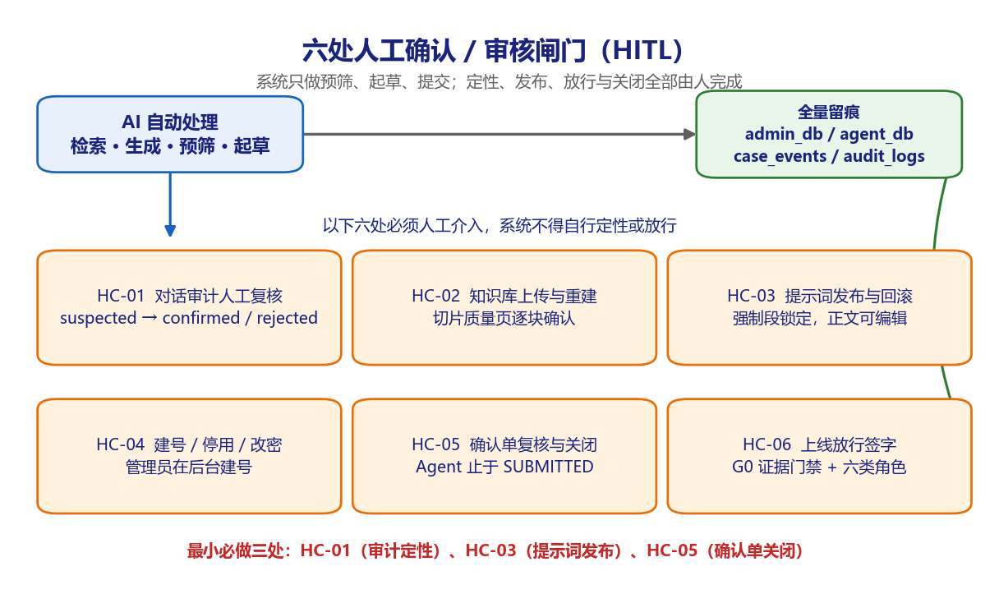
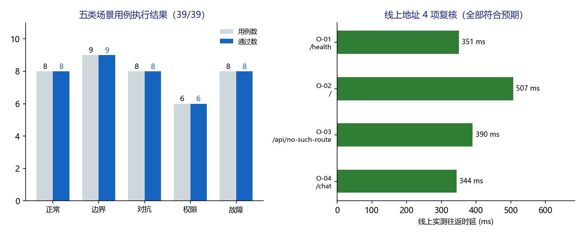
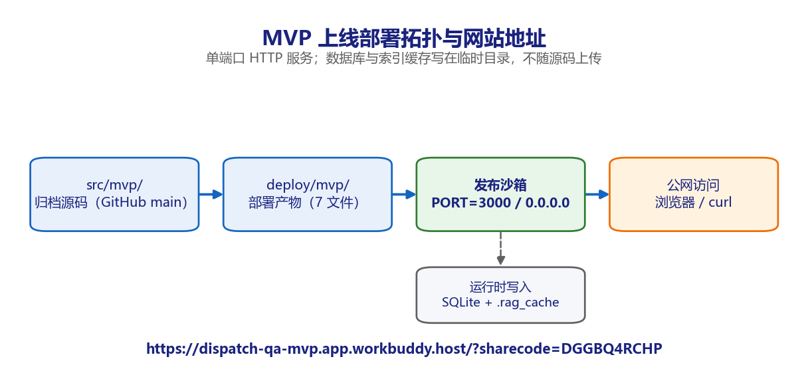

# 派遣项目考勤异常双向确认系统 · 项目上线交付运行手册 v1.0

**版本** v1.0（上线交付稿，含 src 与 Test 两大部分，2026 年 11 月 6 日）
**适用对象** 项目交付经理、运维工程师、测试工程师、业务管理员、客户方验收代表

---

## 1. 交付说明与阅读指引

### 1.1 本次交付清单

本手册是「派遣项目考勤异常双向确认系统」上线交付的主索引文档，覆盖源代码说明、测试方案、五类场景的可视化测试过程与线上部署地址。所有文件统一放在 `output/上线交付运行手册-v1.0/` 目录。

| 序号 | 文件 | 格式 | 内容 | 主要读者 |
| --- | --- | --- | --- | --- |
| 1 | 项目上线交付运行手册.docx | DOCX | 本文件：src 说明、Test 索引、部署与运行 | 全员 |
| 2 | 测试方案.md / 测试方案.docx | MD + DOCX | 39 条量化用例、五类场景、阈值与判定 | 测试 / 验收 |
| 3 | 正常场景测试.docx | DOCX | 8 条用例，含流程图与结果图 | 测试 / 业务 |
| 4 | 边界场景测试.docx | DOCX | 9 条用例，含流程图与结果图 | 测试 |
| 5 | 对抗场景测试.docx | DOCX | 8 条用例，含攻击面与防线图 | 安全 / 测试 |
| 6 | 权限场景测试.docx | DOCX | 6 条用例，含状态机与门禁图 | 安全 / 架构 |
| 7 | 故障场景测试.docx | DOCX | 8 条用例，含注入与恢复时间线 | 运维 / 测试 |
| 8 | MVP系统上线部署地址说明.docx | DOCX | 线上地址、验证记录、访问限制、下线方式 | 运维 / 客户 |
| 9 | results/test_results.json | JSON | 39 条用例的逐条实测数据 | 测试 / 审计 |
| 10 | results/build_selfcheck.log | LOG | 全量构建自检 7 项通过的原始输出 | 运维 / 审计 |

### 1.2 环境与事实基线

| 项目 | 基线 | 说明 |
| --- | --- | --- |
| 代码仓库 | GitHub `httpd114/attendance`，分支 `main` | 公开仓库；当前树 83 个文件 |
| 归档问答助手 | `src/mvp/`（6 个文件） | 阶段 2 SSE 聊天 MVP，历史归档，不再迭代 |
| 维护中的完整实现 | `src/attendance_agent/`（28 个文件，约 6,900 行） | 含 JWT、租户隔离、后台、Agent Harness |
| 部署产物 | `deploy/mvp/`（7 个文件） | 从归档版复制，仅一行路径改动 + 新增启动入口 |
| 本地验证解释器 | Python 3.13（已装项目依赖） | CI 已在 Python 3.13 全绿；3.11 因 numpy 下限退出矩阵 |
| 线上运行环境 | 单端口 HTTP 沙箱，`PORT=3000`，绑定 `0.0.0.0` | SQLite 与索引缓存写在临时目录 |
| 模型状态 | 未配置 `LLM_API_KEY`，运行 `MockLLM` + 纯 BM25 | 演示口径，回答不具备业务参考价值 |
| 制度知识源 | `报销制度.md`（示例，4,824 字节，11 个切片） | 文档首行明确「非真实经营制度」 |

### 1.3 三条必须先读的边界声明

- **本次交付的是「可运行的 MVP 演示环境」，不是生产系统。** 完整实现仍有 12 项 P0 上线阻塞未关闭，见 `docs/上线前检查清单-派遣考勤异常双向确认-v1.0.md`。手册中的「上线部署地址」指演示环境发布链接，不代表生产放行。
- **归档版与完整实现是两条线。** `src/mvp/` 是匿名、无后台、无 Agent 的阶段 2 原型；Agent 框架、管理后台、租户隔离都在 `src/attendance_agent/`。不得把后者的能力说成前者的交付成果。
- **测试数字均来自本机与线上实测。** 39 条用例的执行数据保存在 `results/test_results.json`，构建自检输出保存在 `results/build_selfcheck.log`，可复算、可追溯；文中不含估算或占位数字。

## 2. src：源代码交付

### 2.1 问答助手归档

`src/mvp/` 是项目「最早能跑起来的那一版」员工问答助手：本地制度 Markdown → 混合检索 → SSE 流式回答 → SQLite 留痕。单进程、匿名、无登录、无后台，一个页面一个接口。

| 文件 | 来源 | 处理 |
| --- | --- | --- |
| rag_engine.py | Git 提交 `0ffc8f4:chat-app/rag_engine.py` | 原样归档，SHA-256 字节一致 |
| static/index.html | `0ffc8f4:chat-app/static/index.html` | 原样归档，字节一致 |
| 报销制度.md | `0ffc8f4:chat-app/报销制度.md` | 原样归档，字节一致 |
| main.py | 按阶段 2 接口契约重建的薄编排层 | 历史入口已耦合登录与后台，无法干净剥离 |
| README.md / requirements.txt | 归档时新增 | 启动说明与最小依赖 |

历史 `main.py` 在阶段 2 之后叠加了登录鉴权、租户隔离、知识库后台、对话审计与用户管理，单文件涨到 1,775 行，且建表 SQL 缺 `tenant_id`、必须先跑 `migrate.py` 补列才能启动。照搬既不是 MVP 也无法独立运行，因此归档版只保留阶段 2 的协议编排，算法层仍调用原版 `RAGEngine.stream_chat()`，分层纪律不变。

接口契约如下，事件顺序固定，任一步失败改发 `error` 且之后不再发其他事件。

| 方法 | 路径 | 说明 |
| --- | --- | --- |
| POST | /chat | SSE 流式问答，请求体 session_id 可选、question 必填 |
| GET | /api/sessions/会话ID/messages | 刷新页面后恢复会话历史 |
| GET | /health | 存活、索引块数、向量路开关、当前模型 |
| GET | / | 单页聊天界面 |

SSE 事件顺序：`meta → status(retrieving) → citations → status(generating) → delta* → done`。非 200 与流内错误统一返回 `code / message(中文) / detail / request_id` 四段结构。

归档版的五条已知限制（阶段 2 原貌，非缺陷清单）：匿名无隔离、限流是进程内存计数、引用自检只能查编号越界、无管理后台与 Agent 编排、默认 MockLLM 回答质量不代表线上效果。

### 2.2 MVP 工程架构

四层自上而下单向依赖：接入层只负责渲染与合帧；编排层处理 HTTP、SSE 帧、限流与中文错误体；算法层负责切节、检索、引用自检与提示词组装；存储层保存制度原文、会话消息与索引缓存。算法层不感知 HTTP，接口层不碰算法。

关键参数取自 `rag_engine.Config`：切片 500 字、重叠 50 字、最小块长 30 字；检索 top_k=3、RRF k=60、BM25 候选 20；历史最近 6 轮且总字数上限 3,000；问题长度上限 500 字；限流 20 次 / 60 秒。检索采用 BM25 词级 + 字符二元组双路加向量路（可用时）RRF 融合；字符二元组专为解决中文分词不一致导致的漏召回。

无密钥时的降级策略是本项目最重要的一条工程教训：embedding 不可用时**整条关闭向量路**，退化为纯 BM25，绝不用哈希伪向量参与排序——早期版本正是被无语义向量把正确结果挤出 Top3。

部署产物 `deploy/mvp/` 与归档源码的关系：三个核心文件字节一致；`main.py` 仅把 `CFG.index_dir` 改为可由 `INDEX_DIR` 覆盖（沙箱应用目录只读）；新增 `serve.py` 读取 `PORT`、绑定 `0.0.0.0`、把数据库与索引指到临时目录；新增 `requirements.txt` 与部署专用 README。上传前已确认目录内无 `.db`、`.faiss`、`.pyc` 或 `__pycache__`。

### 2.3 Agent 框架

完整实现采用**自建轻量 Harness**（`src/attendance_agent/core/agent_loop.py`），不引入 LangGraph、LangChain AgentExecutor、AutoGen、CrewAI 或 Assistants API。理由：本项目需要的是「模型决策 → 串行执行工具 → 结果一次性回填 → 再决策」这一条固定回路，外加每轮日志落表与服务端硬门禁；通用框架的抽象层会带来不可控的隐式重试与状态管理，反而削弱可审计性。

一轮的定义：一次模型决策、串行执行本轮全部 `tool_calls`、把结果一次性回填消息列表；最多 5 轮，超出记 `agent_round_limit` 并停止。`GLMClient` 对接智谱 OpenAI 兼容接口，`ScriptedLLM` 供离线轨迹复现，`AgentHarness` 与两者通过 `LLMClient` 协议解耦。

九个工具按角色裁剪：员工可用 9 个，管理员仅 4 个只读工具（`list_my_exceptions`、`get_exception_detail`、`lookup_policy`、`get_case_state`），写类工具不出现在管理员工具集里。

| 工具 | 作用 | 类别 |
| --- | --- | --- |
| list_my_exceptions | 列出本人本租户待处理考勤异常 | 只读 |
| get_exception_detail | 读取打卡、排班、规则命中与备注 | 只读 |
| lookup_policy | 检索适用制度条款 | 只读 |
| get_case_state | 读取服务端客观状态 | 只读 |
| validate_evidence | 校验证明材料完整性 | 校验 |
| create_confirmation_draft | 生成确认单草稿 | 写 |
| validate_policy_compliance | 校验草稿与制度一致性 | 校验 |
| submit_confirmation | 提交到管理员复核队列 | 写 |
| escalate_case | 材料不足时升级上报 | 安全动作 |

状态机为 `IDLE → EVIDENCE_CHECKED → DRAFT_CREATED → COMPLIANCE_CHECKED → SUBMITTED`，`escalate_case` 从任意状态可达 `ESCALATED`。**SUBMITTED 是 Agent 的权限天花板**：`CLOSED` / `REJECTED` 不定义跃迁、不注册工具，只能由管理员在后台点击产生。

四层防护：L1 角色裁剪工具集；L2 一次性 HMAC 能力令牌（签名、300 秒有效期、身份与租户、动作、`jti` 原子消费、`params_hash`、服务端状态机）；L3 幂等与全量审计；L4 系统提示词只优化效率，不承担正确性。日志落在 `agent_rounds`（决策类型、工具名、助手文本、时延、token、提示词与制度版本）与 `agent_tool_calls`（脱敏参数、时延、240 字结果摘要、错误码、能力令牌 jti）两张表。

三条实测轨迹：T1 正常确认 5 轮 / 8 工具 / 停在 `SUBMITTED`；T2 跳步被拦后自愈、两次拒绝、停在 `COMPLIANCE_CHECKED`、零越权提交；T3 材料不足 4 轮 / `ESCALATED` / 零确认单。另有 8 条硬门禁单测，均由 `scripts/build.sh` 自动执行并通过。

**当前状态必须如实说明**：Agent Harness 是独立可运行模块，尚未挂入 `main.py` 的稳定聊天链路；`make_rag_policy_lookup(_KB)` 未适配真实 `KnowledgeBase.retrieve()` 签名时会静默回退到 demo 制度片段。这两项属于生产接入前的待办，不是已交付能力。

### 2.4 知识库

知识库分两套并行，交付时必须区分，不能混用。

| 知识源 | 位置 | 用途 | 状态 |
| --- | --- | --- | --- |
| RAG 制度文档 | `data/报销制度.md`、`src/mvp/报销制度.md`、后台 `kb_documents` / `kb_chunks` 表 | 员工制度问答、引用编号 | 已在用 |
| Agent demo 制度片段 | `agent_tools.py` 中的 `POL-*` 片段 | 三条离线轨迹的合规校验演示 | 仅演示 |

处理链路：Markdown 标题切节（不再用固定 500 字硬切，避免跨章节混块）→ 切片入库 → 建 BM25 与向量索引 → 混合检索 → 引用编号 `[1][2]` → 生成 → 引用完整性自检。拒答白名单用于避免「正确拒答」被自检误报。

提示词分两段：`build_system_prompt()` 拼接的**强制段**由代码硬编码（引用编号规则、拒答规则），管理员在后台改不了；**业务正文段**可在 `/admin/prompts` 编辑、保存新版本并回滚，版本变化写入 `prompt_templates` 与审计日志。管理员还可在 `/admin/knowledge/documents/文档ID/chunks` 逐块检查切片质量，这是知识库侧最主要的人工检查点。

四项遗留风险：引用编号可能「未越界但指错块」，语义校验未根治；两套知识源章节号冲突，需要统一 `chunk_id` 命名空间；`make_rag_policy_lookup` 的签名适配问题；`AGENT_GATE_SECRET` 未配置时 `dev_mode` 固定派生密钥，仅够演示。

### 2.5 人工确认与审核点

系统只做预筛、起草、提交；定性、发布、放行与关闭全部由人完成。下表六处中，**HC-01、HC-03、HC-05 是最小必做三处**，缺少任何一处均不得宣称具备人工回路。

| 编号 | 人工确认点 | 触发与入口 | 系统前置拦截 | 人工动作 | 留痕位置 |
| --- | --- | --- | --- | --- | --- |
| HC-01 | 对话审计人工复核 | 规则预筛命中后进入 `/admin/audit` | `audit_rules.py` 20 条关键词 + 3 条正则，权重阈值 2，只生成 `suspected` | 管理员在 `/admin/audit/flags/标记ID/review` 判 `confirmed` 或 `rejected` | `audit_flags` 的 `reviewed_at` / `reviewed_by` + `audit_logs` |
| HC-02 | 知识库上传与重建索引 | `/admin/knowledge/upload`、`/admin/knowledge/reindex` | 按租户隔离；删除与重建需显式 POST | 上传后到切片质量页逐块确认，再决定是否重建 | `kb_documents` / `kb_chunks` + `audit_logs` |
| HC-03 | 提示词发布与回滚 | `/admin/prompts/save`、`/admin/prompts/rollback` | 强制段由代码锁定，管理员只能改业务正文 | 管理员保存新版本并可回滚，记录版本号与操作人 | `prompt_templates` + `audit_logs` |
| HC-04 | 建号 / 停用 / 改密 | `/api/admin/users`、`/admin/users/toggle`、`reset-password` | `require_admin` 依赖；停用账号每次请求查库使 JWT 立即失效 | 管理员在后台建号，不开放注册 | `users` + `audit_logs` |
| HC-05 | 确认单复核与关闭 | 完整实现的后台复核队列 | Agent 工具集无 `close_case` / `reject_case`，状态机无对应跃迁 | 管理员点击通过 / 驳回 / 关闭，系统不因超时自动通过 | `case_events` + `confirmation_cases` |
| HC-06 | 上线放行签字 | G0 证据门禁与 G4 上线放行 | 12 项 P0 阻塞、7 项 P1 补偿方案、`scripts/deploy.sh` 密钥检查 | 六类角色书面签字，缺一不放行 | 上线前检查清单 + 发布记录 |

三处最小必做点的验收口径：HC-01 抽查 10 条 `suspected` 标记，系统自动定性数必须为 0；HC-03 检查提示词版本表，强制段哈希在保存前后必须一致；HC-05 用跳步轨迹验证，越权提交数必须为 0。

### 2.6 已知限制与遗留风险

| 项 | 现状 | 影响 | 处置建议 |
| --- | --- | --- | --- |
| 限流 | 进程内存计数 | 多 worker / 重启不共享 | 生产换 Redis，接口 `allow(key)` 已预留 |
| 密钥 | 开发默认值 | 生产不可用 | `deploy.sh` 缺三个密钥时拒绝启动 |
| 日志保留 | 无策略 | 审计与合规风险 | 制定保留期与脱敏规则 |
| Agent 接入 | 未挂入主聊天链路 | 能力未端到端可用 | 按说明文档补薄路由后再验收 |
| 两套知识源 | 章节号冲突 | 引用可能指错块 | 统一 chunk_id 命名空间 |
| git 历史 | 公开仓库旧提交含运行时数据 | 当前 main 已清除，历史可按 SHA 访问 | 需要时用 filter-repo 清理并强推 |

## 3. Test：测试与验收

### 3.1 测试方案索引

《测试方案》同时提供 `测试方案.md` 与 `测试方案.docx` 两种格式，内容一致，包含 39 条量化用例（正常 8、边界 9、对抗 8、权限 6、故障 8）、执行环境、逐条输入与期望、量化阈值、判定规则与责任角色。执行器输出保存在 `results/test_results.json`。

### 3.2 五类场景与实测结果

本轮实测 39 条全部通过，失败 0 条。正常场景 30 次连续问答 P95 为 12.95 ms、首帧 TTFB P95 为 9.75 ms 量级、error 事件 0 个；线上地址四项复核（健康检查 200、首页 200、未知路由 404、SSE 问答 200）往返时延在 343 至 507 ms 之间。

### 3.3 可视化测试过程文档索引

每个场景单独成册，均含封面、流程图、逐用例过程记录、结果图、异常发现与结论签字栏。

| 文档 | 用例数 | 核心图示 | 主要发现 |
| --- | --- | --- | --- |
| 正常场景测试.docx | 8 | 正常流程 + 结果图 | SSE 事件 22 帧、引用命中 2.2 住宿费 |
| 边界场景测试.docx | 9 | 边界判定树 + 结果图 | 校验优先级：空问题先于 session 格式 |
| 对抗场景测试.docx | 8 | 攻击面与防线 + 结果图 | 「伪造发票」同义词未入规则表，列为 P1 缺口 |
| 权限场景测试.docx | 6 | 状态机与四层门禁 + 结果图 | 令牌重放与篡改均被服务端拦截 |
| 故障场景测试.docx | 8 | 注入与恢复 + 结果图 | 限流第 21 次准确返回 429 / 42901 |

### 3.4 上线门禁与判定

验收沿用需求分析方案的 G0 至 G4 五道门禁：G0 证据门禁（补 3 至 5 个真实样本）、G1 字段契约冻结、G2 人工回路与影响清单、G3 审计与追溯、G4 上线放行。本轮 39 条用例覆盖的是 **MVP 演示环境的功能与技术门禁**，不等于 G4 已通过。

判定规则：39 条用例必须 100% 通过；任一 P0 用例失败即整体不通过；性能测试取 30 次重复去掉首次冷启动后的 P50 / P95；错误率口径为失败数除以总数；所有异常必须能在日志或数据库中找到对应留痕。

### 3.5 生产阻塞项声明

以下 12 项 P0 未关闭前不得宣称生产上线：生产密钥与默认值替换、日志保留与脱敏策略、LLM 配额 / token 预算 / 熔断、降级告警链路、提示词注入识别增强、git 版本基线与可回滚制品、回滚演练、限流改 Redis、多租户数据隔离验收、审计抽样复核、Agent 接入主链路、两套知识源统一。详见上线前检查清单原文。

## 4. 部署与运行

### 4.1 上线部署网站地址

**演示环境分享链接：`https://dispatch-qa-mvp.app.workbuddy.host/?sharecode=DGGBQ4RCHP`**

该链接由本轮实际部署产生，部署状态 `verified=true`，类型为单端口 HTTP 服务。完整访问说明、验证记录、禁止事项与下线方式见《MVP系统上线部署地址说明.docx》。应用可在「设置—数据管理—应用」中管理。

### 4.2 部署产物与启动命令

| 步骤 | 命令 | 说明 |
| --- | --- | --- |
| 依赖安装 | `pip install -r requirements.txt` | 在 `deploy/mvp/` 下执行 |
| 本地启动 | `python serve.py` | 默认 `PORT=8000`，绑定 `0.0.0.0` |
| 平台启动 | `PORT=3000 python serve.py` | 发布平台注入端口 |
| 等价启动 | `python -m uvicorn main:app --host 0.0.0.0 --port $PORT` | 不使用 serve.py 时 |

`serve.py` 必须在 import `main` 之前设置 `DB_PATH` 与 `INDEX_DIR`，因为 `main.py` 在模块加载期就读取这两个变量。生产环境若采用 `scripts/deploy.sh`，脚本会在缺少 `LLM_API_KEY` / `JWT_SECRET` / `AGENT_GATE_SECRET` 或使用开发默认值时拒绝启动，并在启动前做 SQLite 在线备份。

### 4.3 线上验证记录

| 编号 | 验证项 | 结果 | 实测 |
| --- | --- | --- | --- |
| O-01 | `/health` | 200，engine_ready=true，chunks=11，vector_enabled=false，llm_model=mock | 350.69 ms |
| O-02 | `/` | 200，返回 18,393 字节单页 HTML | 507.36 ms |
| O-03 | 未知路由 | 404，中文错误体 | 390.43 ms |
| O-04 | `/chat` SSE | 200，22 帧，事件序完整 | 343.80 ms |

### 4.4 日常运行与巡检

| 频率 | 检查项 | 通过标准 | 责任人 |
| --- | --- | --- | --- |
| 每次发布 | `/health` 与首页 | 200，索引块数非零 | 运维 |
| 每日 | 错误码分布 | 5xx 为 0，429 在预期范围 | 运维 |
| 每日 | `agent_rounds` / `audit_flags` 新增量 | 有留痕、无孤儿记录 | 审计管理员 |
| 每周 | SQLite 备份与恢复演练 | 备份可用、可恢复 | 运维 |
| 每周 | 制度文档与提示词版本 | 版本号与后台一致 | 业务管理员 |

### 4.5 常见故障处置

| 现象 | 可能原因 | 处置 |
| --- | --- | --- |
| 429 / 42901 | 同一 IP 60 秒内超过 20 次 `/chat` | 等待窗口或换 Redis 分布式限流；不要直接删计数 |
| 503 / 50001 | 制度文件缺失或索引未构建 | 检查 `DOC_PATH`，服务会拒绝启动而不是带病运行 |
| SSE 一次性全出来 | 反代缓冲 | 确认 `Cache-Control: no-cache`、`X-Accel-Buffering: no` 三个响应头 |
| 回答出现乱码 | 客户端以 GBK 提交 | 用 `--data-urlencode` 或明确 UTF-8 请求头，服务端解码无问题 |
| 历史里有 `streaming` | 上次进程异常退出 | 启动时的 `cleanup_stale_streaming()` 自动标为 error / 50099 |
| 404 / 405 英文错误 | 未走统一错误处理器 | 核对 `check_routes.py` 的 27 条路由自检 |

### 4.6 安全声明与禁止事项

- 演示环境**匿名、无登录、无租户隔离、无审计**，禁止录入任何真实员工、客户或经营数据。
- 知识源是示例制度，文档首行已注明非真实经营制度；`MockLLM` 会回显提示词前 300 字，属演示口径，生产必须换真实模型并重新跑对抗用例。
- 数据库与索引缓存写在沙箱临时目录，不保证持久，不得当作业务数据存储。
- 仓库是 public，`docs/` 中的报价单、需求清单、上线检查清单对外可见；如需保密应先转私有或移出。

### 4.7 回滚与下线

三步：一、在「设置—数据管理—应用」中对本应用执行下线，分享链接立即失效；二、本地保留 `deploy/mvp/` 当前 7 个文件与 `results/` 全部测试证据；三、如需恢复上一版本，从 `src/mvp/` 重新复制三个核心文件与 `main.py`，重跑 `scripts/build.sh` 7 项自检后再发布。禁止在未留存测试证据的情况下覆盖线上版本。

## 5. 附录

### 5.1 交付文件清单

除九份文档外，本目录还包含 `figures/`（14 张 PNG 示意图）、`sources/`（各文档 Markdown 源稿）、`html/`（转换用单文件 HTML）、`results/`（测试 JSON 与构建日志）。DOCX 为交付格式，MD 与 JSON 为可复算证据。

### 5.2 术语与错误码

| 错误码 | 含义 | HTTP |
| --- | --- | --- |
| 40002 | 请求参数不合法 | 400 |
| 40003 | 问题不能为空 | 400 |
| 40004 | 问题长度超过 500 字 | 400 |
| 40005 | session_id 格式不合法 | 400 |
| 40101 | 会话不存在 | 404 |
| 40401 | 接口不存在 | 404 |
| 40501 | 请求方法不支持 | 405 |
| 42901 | 请求过于频繁 | 429 |
| 50001 | 制度索引未构建 | 503 |
| 50099 | 服务内部错误 | 500 |

### 5.3 版本记录与签字栏

| 版本 | 日期 | 变更 | 编制 |
| --- | --- | --- | --- |
| v1.0 | 2026-11-06 | 首次上线交付：src 说明、39 条量化测试、五份可视化过程文档、部署地址 | 项目组 |

| 角色 | 姓名 | 签字 | 日期 |
| --- | --- | --- | --- |
| 交付经理 |  |  |  |
| 测试负责人 |  |  |  |
| 运维负责人 |  |  |  |
| 业务管理员 |  |  |  |
| 客户验收代表 |  |  |  |
